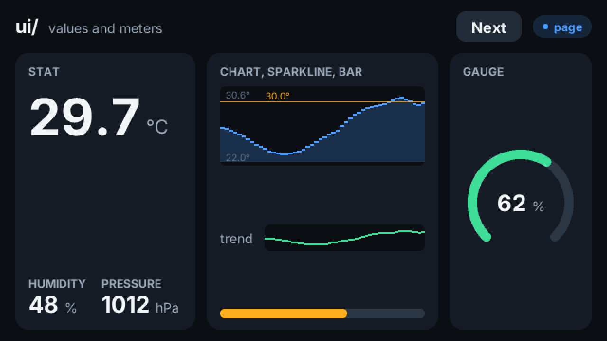
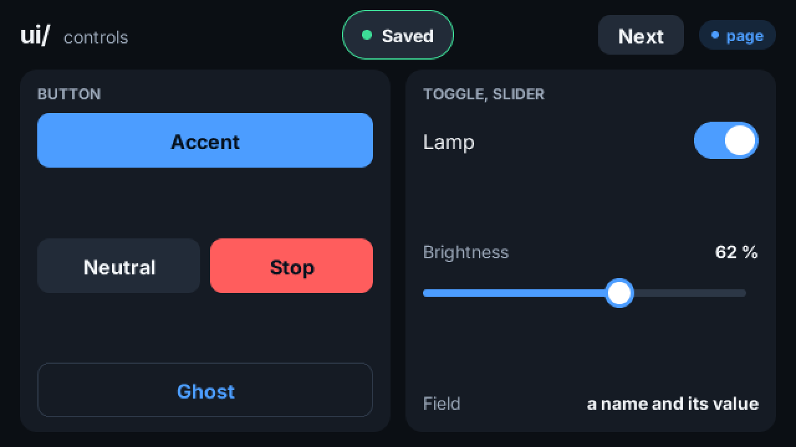
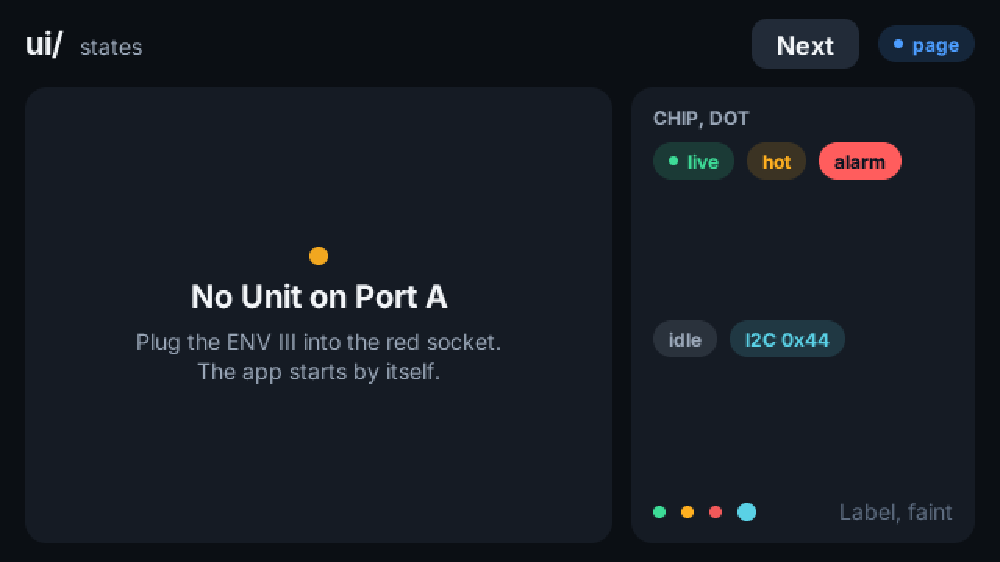

# `ui/`: parts for the Tab5's screen

A small library for 640 x 360 screens, so that an app looks finished without inventing its own layout. Import
from `./ui`. The files are the project's own: read `index.tsx` before changing a part, and change it when it
falls short. `examples/gallery.tsx` draws everything below (`import "./ui/examples/gallery";` as the whole of
`main.tsx` shows it on the Tab5).

| File | What is in it |
| --- | --- |
| `index.tsx` | The parts, and the worker's channels as signals. UI realm only. |
| `theme.ts` | Palettes (dark, light), spacing, radii, font sizes, `GLYPHS`. |
| `channel.ts` | `record()` and `commands()`: the bytes of a channel from named fields. Both realms. |

## A screen

```tsx
import { mount } from "@pocketjs/framework/solid";
import { Button, Card, Chart, Header, Row, Screen, Stat } from "./ui";

mount(() => <Screen>
  <Header title="Weather" subtitle="ENV III on Port A" status="live" tone="good" />
  <Row gap={12} grow align="stretch">
    <Card title="TEMPERATURE" w={220} justify="between">
      <Stat value="24.6" unit="°C" />
      <Button label="Reset" onPress={() => {}} />
    </Card>
    <Card title="LAST MINUTE" grow><Chart values={[24.1, 24.3, 24.6]} h={120} unit="°" /></Card>
  </Row>
</Screen>);
```

`Screen` is the whole display: a column with 16 px to the edges and 12 px between its children. It switches
Port A's power on (`portA={false}` leaves it) and shows the toasts. `Header` is the top line. A `Row` with `grow`
and `align="stretch"` takes the rest of the height and makes its cards equally tall.

## Layout

`Row` (side by side, centred vertically) and `Col` (stacked, as wide as the column) take `gap` (8), `justify`
(`start center end between around`), `align` (`start center end stretch`), `grow`, `w`, `h`. `Spacer` pushes what
follows to the far end. `Card` is a `Col` on a panel with a caption (`title`); `grow` shares the room with its
siblings, `w` fixes its width; with `onPress` the whole card is a button.

## Values and meters



```tsx
<Stat value={celsius().toFixed(1)} unit="°C" />                          // 54 px; size="md" 36 px, "sm" 24 px
<Stat value="48" unit="%" label="HUMIDITY" size="sm" tone="info" />
<Chart values={history()} h={84} unit="°" mark={30} />                    // oldest first; undefined is a gap; mark: a limit line
<Sparkline values={history()} grow tone="good" />                         // in a Row: grow or w
<Bar value={0.62} tone="warn" />                                          // 0..1
<Gauge value={0.62} size={112} tone="good"><Stat value="62" unit="%" size="sm" /></Gauge>
```

A `Chart` draws one column for each entry of `values`: keep the array at a fixed length (60 points for a
minute at one a second) and shift it, so the columns keep their width. Kinds: `area` (default), `bars`, `line`.
The range follows the data unless `min` and `max` are given; `minSpan={2}` keeps a steady value flat instead of
magnifying its noise. It is `h` pixels high; `grow` takes the room that is left (the height in a `Card`, the
width in a `Row`). A history travels as a list field: `"f32[60]"` with NaN for a second without a reading.

## Controls



```tsx
<Button label="Start" tone="accent" onPress={start} />                    // tones: accent neutral good warn bad ghost
<Row gap={8}><Button label="Less" grow onPress={less} /><Button label="More" grow onPress={more} /></Row>
<Toggle label="Lamp" value={on()} onChange={setOn} />
<Slider value={level()} onChange={setLevel} min={0} max={1} step={0.05} w={260} />   // w: the track in pixels
<Field label="Brightness" value={`${Math.round(level() * 100)} %`} />
toast("Saved", "good");                                                   // a line at the top for 2.5 s
```

Controls are 44 px high, the smallest a finger hits reliably. `disabled` greys a `Button` out.

## States



```tsx
<Notice title="No Unit on Port A" lines={["Plug the ENV III into the red socket.", "The app starts by itself."]} />
<Chip tone="good" dot>live</Chip>  <Chip tone="bad" solid>alarm</Chip>  <Chip>idle</Chip>
<Dot tone="bad" pulse />
<Label size="sm" tone="muted">One line of text</Label>
```

A `Notice` takes the place of the cards while there is nothing to show: no Unit, a sensor that stopped
answering. Say which Unit and where it goes. A text is one line: `lines` is a list, one `Label` each.

## Colours

`theme()` is the palette in use: `bg`, `panel`, `raised`, `line`, `text`, `muted`, `faint`, `accent`,
`onAccent`, `good`, `warn`, `bad`, `info`. Call it where the colour is needed (`style={{ bgColor: theme().panel }}`)
and the node follows `setTheme("light")`. Parts take a `tone` (`accent good warn bad info neutral`) or a
`color="#rrggbb"`. `mix(theme().panel, theme().bad, 0.16)` tints a card; `alpha(colour, 0.2)` is a see-through
colour (not on a node with a border: the border's colour shows through).

Text sizes are the nine the framework bakes: `2xs` 10, `xs` 12, `sm` 14, `base` 16, `lg` 18, `xl` 20, `2xl` 24,
`4xl` 36, `5xl` 54 px. The three largest are bold only, the smallest regular only.

## The worker's channels

```ts
// protocol.ts, imported by main.tsx and worker.ts
import { commands, record } from "./ui/channel";
export const State = record({ ok: "bool", celsius: "f32", history: "i16[60]", name: "utf8[24]" });
export const Command = commands({ reset: {}, setAlarm: { celsius: "f32" } });
```

```tsx
const state = useChannel("state", State);                       // a signal of the newest record; State.empty() until the first
<Stat value={state().celsius.toFixed(1)} unit="°C" />
send("commands", Command.encode("setAlarm", { celsius: 30 }));   // false when the ring is full
onChannel("events", Event, event => toast(event.text));         // every record of a ring, as it arrives
```

Fields: `u8 i8 u16 i16 u32 i32 f32 bool`, a list of numbers (`"f32[60]"`), a text of at most N bytes
(`"utf8[24]"`: 8 Chinese characters). `State.bytes` is the record's size and has to fit the channel's
`recordBytes` in `pocket.app.json`. Whole numbers are rounded and kept inside their type's range.

## Chinese text

Chinese written in the source is drawn: `<Label>温度</Label>` needs nothing more. The build bakes every
character of every string literal; a character Inter lacks comes from the face `fonts.json` names,
`../.bench/fonts/cjk.otf` (Hiragino Sans GB W6, prepared by the bench).

- One weight: Chinese looks the same in a bold `Label` and a regular one.
- A character that only arrives at run time (read from a card, from HTTP) and is in no literal draws as a
  hollow box. Add the characters the app may show to `"characters"` in `fonts.json`:
  `{ "fallback": ["../.bench/fonts/cjk.otf"], "characters": "员工访客卡未知" }`.
- Each distinct character costs about 10 KiB of the app: a few hundred are fine, a whole script is not.
- Full-width punctuation (`，。：！？（）`) is in the face too. Emoji are not.
